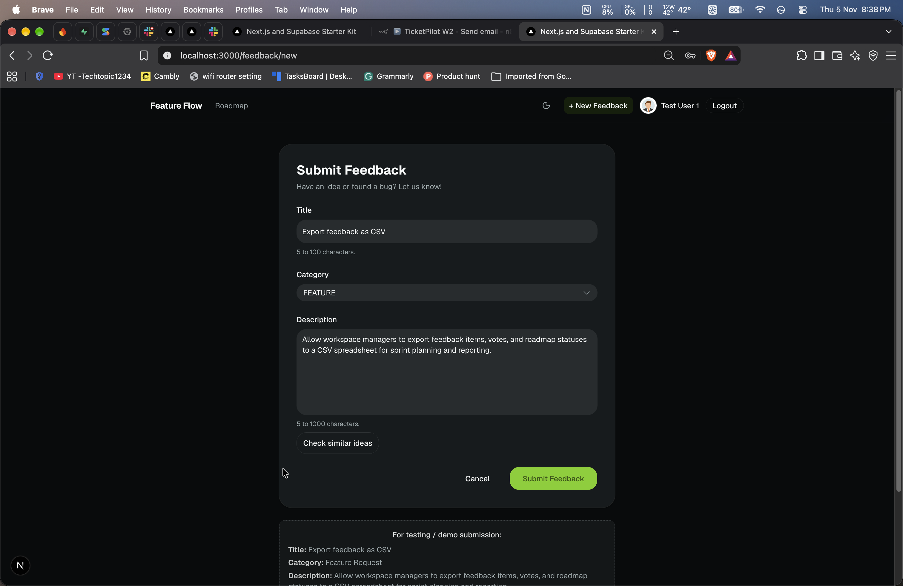

# Feature Flow

[**Live demo**](TODO-add-live-demo-link) | [**Demo video**](TODO-add-demo-video-link)

<!-- HOW TO EDIT THE TWO LINKS ABOVE
1. Live demo: after you deploy, replace TODO-add-live-demo-link with your Vercel address.
2. Demo video: replace TODO-add-demo-video-link with your LinkedIn post or YouTube link.
Until you have a link, delete that word and the "|" next to it.
Also change the Status line below after you deploy. -->

Feature Flow is a website where people share product ideas and bug reports. Other users can upvote and comment. The admin moves each idea across a roadmap. It also has two small AI features: it finds similar ideas, and it adds tags to new posts.

**Status:** works on my computer. Not deployed yet.

> This is a learning and portfolio project. All data is dummy data.

---

## Screenshots

**Home feed (desktop)**


**Home feed (mobile)**


**Login page**


**New feedback form**



**Check similar ideas (AI)**


**Post page with AI tags and comments**


**Roadmap**


**Admin dashboard**


---

## What is this project?

Many companies collect ideas and bug reports in different places. Feature Flow puts them in one public board:

- Users post ideas, upvote the ones they like, and comment.
- The admin changes the status of each idea.
- The roadmap has four columns: Under review, Planned, In progress, Completed.
- Before posting, a user can click a button to check if a similar idea already exists.

It is a project for one company only. I built it to practise the basics of a full-stack app: database design, login, Row Level Security (RLS), Next.js, input checks, and small AI features that do not break the main app.

---

## Features

**For everyone (no login)**

- Home feed with search, category filter (Feature, Bug, UI) and sort (newest or most upvoted)
- The feed shows the latest 20 posts
- Search and filters are saved in the page address, so you can share the link
- Trending sidebar with the 5 most upvoted posts
- Roadmap page with four columns
- Post page with the full text and the comments
- Dark mode and light mode, and it works on mobile

**For logged-in users**

- Login with email and password, or with Google. Password reset by email
- Create a post
- Upvote a post. One vote per user per post. Click again to remove your vote
- Comment on a post
- Delete your own post or comment (a "soft delete": the row stays in the database)

**AI features**

- "Check similar ideas" button on the new post form. It shows up to 3 similar ideas
- After you post, the app adds up to 3 tags and flags posts that look like spam

**For the admin**

- Admin link in the navbar (only the admin sees it)
- Dashboard with four numbers: open posts, waiting for review, flagged by AI, completed. It also shows posts per category
- List of posts flagged by AI. The admin can dismiss a flag
- List of deleted posts. The admin can restore a post
- Change the status of a post on the post page
- A backfill route that creates AI embeddings for old posts (`/api/admin/embed-existing`, admin only)

---

## Pages

| Page                           | Address          | Who can open it                                    |
| ------------------------------ | ---------------- | -------------------------------------------------- |
| Home feed                      | `/`              | Everyone                                           |
| Roadmap                        | `/roadmap`       | Everyone                                           |
| Post page                      | `/feedback/<id>` | Everyone can read. Login needed to vote or comment |
| New feedback                   | `/feedback/new`  | Login needed to submit                             |
| Admin dashboard                | `/admin`         | Admin only                                         |
| Login, sign up, password reset | `/auth/...`      | Everyone                                           |

---

## Tech stack

| Part               | Technology                               |
| ------------------ | ---------------------------------------- |
| Framework          | Next.js 16 (App Router) and React 19     |
| Language           | TypeScript                               |
| Database and login | Supabase (Postgres, Auth, RLS, pgvector) |
| Styling            | Tailwind CSS v4 and shadcn/ui            |
| Input checks       | Zod                                      |
| AI                 | Vercel AI SDK with Google Gemini         |

---

## How it works

In short:

- Pages read data on the server.
- All changes (post, vote, comment, admin actions) go through Server Actions.
- The "Check similar ideas" button calls one API route.
- The AI provider is only used for embeddings and tags.

### What happens when you create a post

1. You send the form.
2. The server checks that you are logged in and that the input is valid.
3. The post is saved.
4. If you are under the daily limit, the AI step runs. It creates the tags, the spam flag and an embedding.
5. If the AI fails, the error is ignored. The post is already saved.
6. You go back to the home page.

<!-- CHECK: the exact daily limit rule is in src/lib/ai-step.ts (AI_DAILY_POST_LIMIT = 5). Confirm if the 6th post is skipped, and fix the sentence in step 4 and in the AI table if needed. -->

The most important rule: **AI is a bonus, not a requirement.** If the AI is slow or broken, posting, voting and commenting still work.

---

## Database

| Table                 | What it is for                                                  |
| --------------------- | --------------------------------------------------------------- |
| `profile`             | One row per user: name, avatar and role (USER or ADMIN)         |
| `feedback`            | The posts, including soft delete and AI columns                 |
| `comment`             | Comments on a post                                              |
| `vote`                | One row per vote. A unique pair (post, user) stops double votes |
| `feedback_embeddings` | One vector per post, used to find similar posts                 |

There is also a view, `vw_feedback_details`, that adds the vote and comment counts in SQL. A function, `match_similar_feedback`, finds the closest posts to a vector.

The full SQL is in [`docs/feature_flow_schema.sql`](docs/feature_flow_schema.sql).

---

## Security

I use a few small layers, so one mistake does not open everything.

- **RLS is on for every table.** The database decides who can read or change which rows.
- **Admin checks happen on the server.** The admin page and every admin action call `requireAdmin()` first. Hiding a button is not security.
- **Users cannot make themselves admin.** The database blocks role changes. The first admin is made by hand with one SQL line.
- **The secret key stays on the server.** It is only used in one server-only file and is never sent to the browser.
- **All form and API input is checked with Zod.** Search text is cleaned before it is used in a query.
- **AI is limited.** Only a few posts per user per day get the AI step. The AI never deletes or edits a post by itself, and the post text is treated as data, not as instructions.

---

## AI features in detail

**Check similar ideas.** The app turns your title and description into a vector (a list of numbers). The database then finds the closest posts above a similarity score. The button never blocks posting. If the AI is down, it shows "AI suggestions are temporarily unavailable".

**Tags and spam flag.** After a post is saved, the app asks the model for up to 3 tags and a spam flag with a short reason. The answer is checked with a Zod schema. A flagged post goes to the admin page, where a person decides what to do.

| Item                  | Value                                                  |
| --------------------- | ------------------------------------------------------ |
| Embedding model       | `gemini-embedding-001`                                 |
| Vector size           | 768                                                    |
| Similarity            | Cosine similarity                                      |
| Similarity score used | 0.8 (I have not tested other values much)              |
| Tags and spam model   | Set by `LLM_MODEL`. Default is `gemini-3.1-flash-lite` |
| AI time limit         | 10 seconds per call                                    |
| AI daily limit        | First 5 posts per user in 24 hours                     |

---

## Run it on your computer

### What you need

- Node.js 20 or newer
- A free [Supabase](https://supabase.com/) project
- A Google AI (Gemini) API key
- (Optional) A Google Cloud OAuth client, for Google login

### Steps

**1. Get the code and install**

```bash
git clone <your-repo-url>
cd feature-flow-full-stack-app
npm install
```

**2. Create the database**

In Supabase, open the SQL Editor and run `docs/feature_flow_schema.sql`.

**3. Set up login**

In Supabase, go to Authentication, then URL Configuration.

- Set Site URL to `http://localhost:3000`.
- Add these Redirect URLs:
  - `http://localhost:3000/auth/callback`
  - `http://localhost:3000/auth/update-password`

For Google login, create an OAuth client in Google Cloud. Use your Supabase callback address as its redirect address. Then paste the client ID and secret in Authentication, then Providers, then Google.

**4. Add environment variables**

Copy `.env.example` to `.env.local` and fill it in:

| Variable                               | Used for                               |
| -------------------------------------- | -------------------------------------- |
| `NEXT_PUBLIC_SUPABASE_URL`             | Supabase project address               |
| `NEXT_PUBLIC_SUPABASE_PUBLISHABLE_KEY` | Supabase public key                    |
| `SUPABASE_SECRET_KEY`                  | Server-only key. Never share it        |
| `GOOGLE_GENERATIVE_AI_API_KEY`         | Gemini API key                         |
| `LLM_MODEL`                            | Optional. Model for tags and spam flag |

> Never commit `.env.local`. The secret key must stay on the server.

**5. Start the app**

```bash
npm run dev
```

Open [http://localhost:3000](http://localhost:3000).

**6. Make yourself admin**

Sign up first. Then run this once in the Supabase SQL Editor, with your own email:

```sql
update public.profile set role = 'ADMIN'
where id = (select id from auth.users where email = 'you@example.com');
```

**7. (Optional) Add sample data**

There is no seed script. The file [`docs/dummy-feedbacks-and-comments.txt`](docs/dummy-feedbacks-and-comments.txt) has sample users, posts and comments that you can add by hand. If you add old posts without the app, an admin can open `/api/admin/embed-existing` to create their AI embeddings.

### Useful commands

| Command         | What it does                  |
| --------------- | ----------------------------- |
| `npm run dev`   | Start the app for development |
| `npm run build` | Make a production build       |
| `npm run start` | Run the production build      |
| `npm run lint`  | Check the code style          |

---

## Demo accounts

<!-- Fill this in when the demo accounts are final. The login page also shows test accounts.
Delete this whole section if you do not give visitors a login. -->

| Role  | Email | Password |
| ----- | ----- | -------- |
| User  | TODO  | TODO     |
| Admin | TODO  | TODO     |

These accounts are for the demo only. Please do not enter real personal information.

---

## Try it yourself

1. Open the home page. Use the search, the category filter and the sort.
2. Log in as the demo user. Click **New feedback** and type a title and description.
3. Click **Check similar ideas** to see if a similar post already exists.
4. Submit the post. After a moment, open it and look at the AI tags.
5. Upvote a post and add a comment.
6. Open the **Roadmap** page.
7. Log in as the admin and open **Admin**. Look at the numbers, dismiss a flag, or change the status of a post.

---

## Known limits

I want to be honest about what this project does not do yet:

- **No automated tests.** I test by hand.
- **Feed shows only the latest 20 posts.** There is no pagination. I removed it to keep the project small.
- **One admin, made by hand.** There is no screen to manage users.
- **No avatar upload.** The avatar is a link you type.
- **Deleted posts can still be read through the API.** The post page only shows a "deleted" message.
- **The AI step runs while the user waits** (about 1 to 3 seconds). A background job would be better.
- **I did not test the similarity score much.** 0.8 is a starting value.
- **No general rate limit.** Only the daily AI limit exists.

---

## What I learned

- **RLS is a second lock.** The database protects data even if my app code forgets a check.
- **Server Actions are public endpoints.** Every admin action checks the role on the server.
- **The URL is good for state.** Filters and search live in the address, and Zod makes the values safe.
- **Embeddings.** Text becomes a vector. Similar text gives close vectors.
- **AI must be optional.** A try/catch, a time limit and a daily limit keep the app working when the model fails.
- **Cutting scope is a skill.** I removed pagination and the seed script, and I kept what I can explain.

---

## Contact

Asim Momin · Full-stack developer (fresher)

[GitHub](https://github.com/asim-momin-7864) · [LinkedIn](http://www.linkedin.com/in/asim-momin7864) · Email: TODO

<!-- Add your email and, if you have one, your portfolio link. -->
