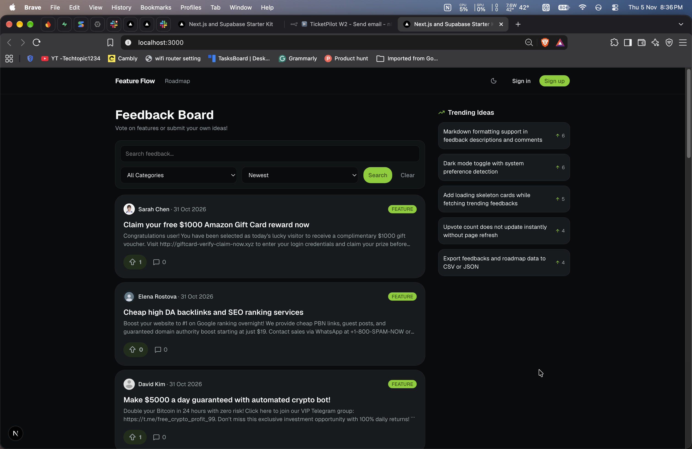
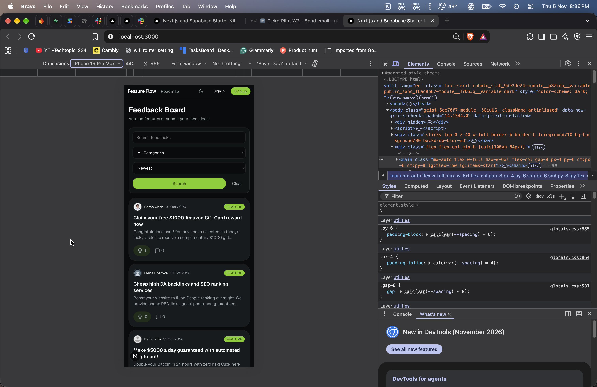
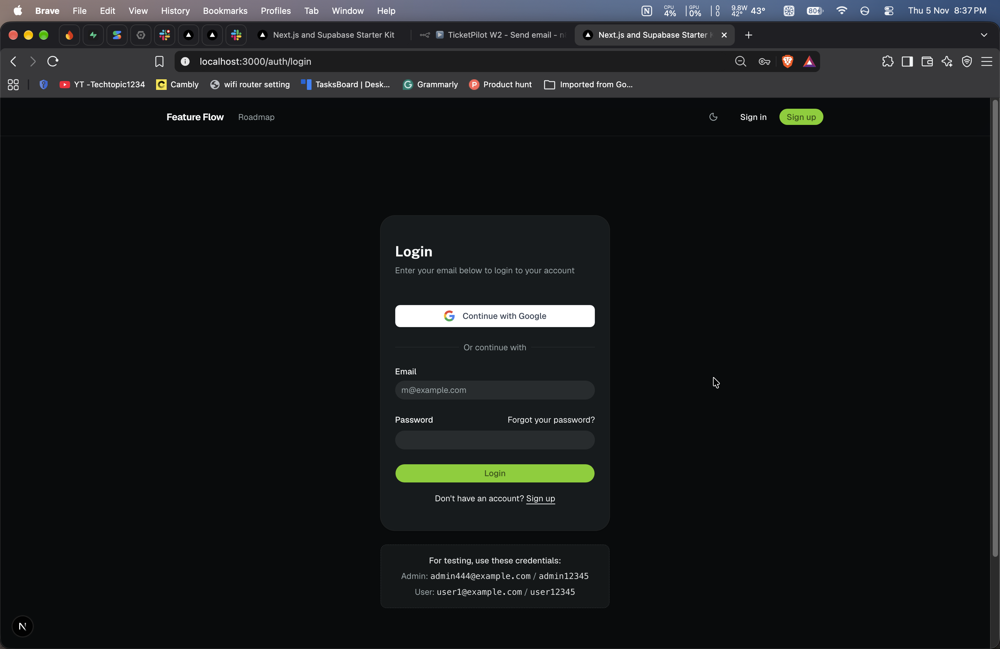
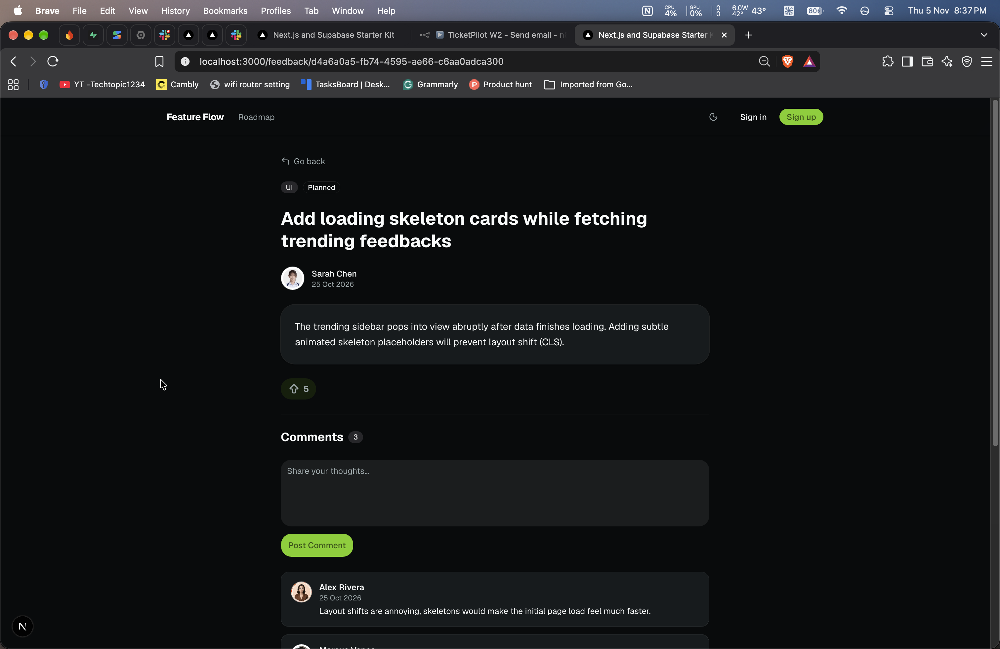
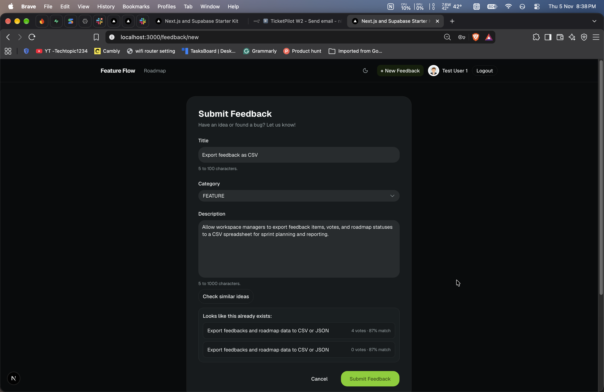
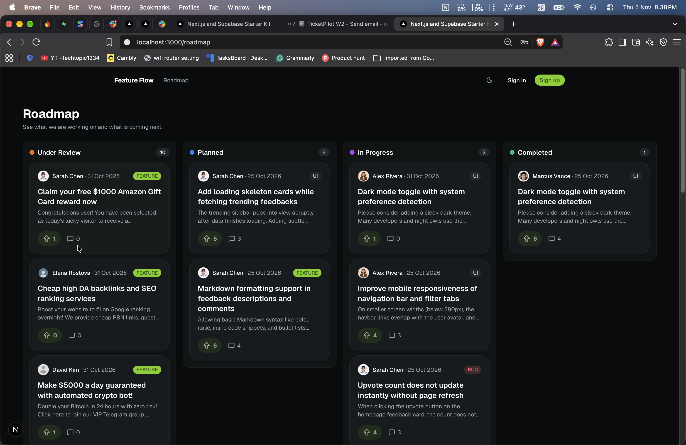
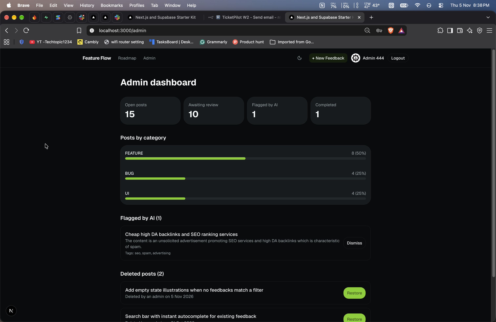

# Feature Flow

Feature Flow is a website where people share product ideas and bug reports.
Other users can upvote and comment. The admin moves each idea across a roadmap.
It also has two small AI features: it finds similar ideas, and it adds tags to new posts.

---

[Deploy Live Link](https://feature-flow-full-stack-ai-app.vercel.app)

[Source Code](https://github.com/asim-momin-7864/feature-flow-full-stack-ai-app)

---

## Screenshots

**Home feed (desktop)**



**Home feed (mobile)**



**Login Page**



**Post page with AI tags and comments**



**Check similar ideas**



**Roadmap**



**Admin dashboard**



---

## What is this project?

Many companies collect ideas and bug reports in different places. Feature Flow puts them in one public board:

- Users post ideas, upvote the ones they like, and comment.
- The admin changes the status of each idea.
- The roadmap has four columns: Under review, Planned, In progress, Completed.
- Before posting, a user can click a button to check if a similar idea already exists.

It is a project for one company only. I built it to practise the basics of a full-stack app: database design, login, row level security (RLS), Next.js, input checks, and small AI features that do not break the main app.

---

## Features

**For everyone**

- Home feed with search (by title), category filter and sort (newest or most upvoted)
- The feed shows the latest 20 posts
- Search and filters are saved in the page address, so you can share the link
- Trending sidebar with the 5 most upvoted posts
- Roadmap page with four columns
- Post page with the full text, an upvote button and comments
- One vote per user per post. Click again to remove your vote
- Delete your own post or comment (it is a "soft delete": the row stays in the database)
- Login with email and password, or with Google
- Works on mobile, and has dark mode

**AI features**

- "Check similar ideas" button on the new post form. It shows up to 3 similar ideas
- After you post, the app adds up to 3 tags and flags posts that look like spam

**For the admin**

- Admin link in the navbar (only the admin sees it)
- Dashboard with four numbers: open posts, waiting for review, flagged by AI, completed
- List of posts flagged by AI. The admin can dismiss a flag
- List of deleted posts. The admin can restore a post
- Change the status of a post on the post page

---

## Tech stack

| Part               | Technology                               |
| ------------------ | ---------------------------------------- |
| Framework          | Next.js (App Router) and React 19        |
| Language           | TypeScript                               |
| Database and login | Supabase (Postgres, Auth, RLS, pgvector) |
| Styling            | Tailwind CSS v4 and shadcn/ui            |
| Input checks       | Zod                                      |
| AI                 | Vercel AI SDK with Google Gemini         |

---

## How it works

In short:

- Pages read data on the server.
- All changes (post, vote, comment, admin actions) go through Server Actions.
- The "Check similar ideas" button calls one API route.
- The AI provider is only used for embeddings and tags.

### What happens when you create a post

1. You send the form.
2. The server checks that you are logged in and that the input is valid.
3. The post is saved.
4. If you have made 5 posts or fewer in the last 24 hours, the AI step runs. It creates the tags, the spam flag and an embedding.
5. If the AI fails, the error is ignored. The post is already saved.
6. You go back to the home page.

The most important rule: **AI is a bonus, not a requirement.** If the AI is slow or broken, posting, voting and commenting still work.

---

## Database

| Table                 | What it is for                                                  |
| --------------------- | --------------------------------------------------------------- |
| `profile`             | One row per user: name, avatar and role (USER or ADMIN)         |
| `feedback`            | The posts, including soft delete and AI columns                 |
| `comment`             | Comments on a post                                              |
| `vote`                | One row per vote. A unique pair (post, user) stops double votes |
| `feedback_embeddings` | One vector per post, used to find similar posts                 |

There is also a view, `vw_feedback_details`, that adds the vote and comment counts in SQL. A function, `match_similar_feedback`, finds the closest posts to a vector.

The full SQL is in `supabase/schema.sql`.

**Database diagram**

_(add screenshot here)_

---

## Security

I use a few small layers, so one mistake does not open everything.

- **RLS is on for every table.** The database decides who can read or change which rows.
- **Admin checks happen on the server.** The admin pages and every admin action call `requireAdmin()` first. Hiding a button is not security.
- **Users cannot make themselves admin.** The first admin is made by hand with one SQL line.
- **The secret key stays on the server.** It is only used in one server-only file and is never sent to the browser.
- **All input is checked with Zod.**
- **AI is limited.** Only the first 5 posts per user per day get the AI step. The AI never deletes or edits a post by itself.

---

## AI features in detail

**Check similar ideas.** The app turns your title and description into a vector (a list of numbers). The database then finds the 3 closest posts. The button never blocks posting. If the AI is down, it shows "AI suggestions are temporarily unavailable".

**Tags and spam flag.** After a post is saved, the app asks the model for up to 3 tags and a spam flag. The answer is checked with a Zod schema. A flagged post goes to the admin page, where a person decides what to do.

| Item            | Value                              |
| --------------- | ---------------------------------- |
| Embedding model | `gemini-embedding-001`             |
| Vector size     | 768                                |
| Similarity      | Cosine similarity                  |
| AI limit        | First 5 posts per user in 24 hours |

---

## Run it on your computer

### What you need

- Node.js 20 or newer
- A free [Supabase](https://supabase.com/) project
- A Google AI (Gemini) API key
- (Optional) A Google Cloud OAuth client, for Google login

### Steps

**1. Get the code and install**

```bash
git clone <your-repo-url>
cd feature-flow-full-stack-app
npm install
```

**2. Create the database**

In Supabase, open the SQL Editor and run `supabase/schema.sql`.

**3. Set up login**

In Supabase, go to Authentication, then URL Configuration.

- Set Site URL to `http://localhost:3000`.
- Add `http://localhost:3000/auth/callback` to the Redirect URLs.

For Google login, create an OAuth client in Google Cloud and paste its ID and secret in Authentication, then Providers, then Google.

**4. Add environment variables**

Copy `.env.example` to `.env.local` and fill it in:

| Variable                               | Used for                          |
| -------------------------------------- | --------------------------------- |
| `NEXT_PUBLIC_SUPABASE_URL`             | Supabase project address          |
| `NEXT_PUBLIC_SUPABASE_PUBLISHABLE_KEY` | Supabase public key               |
| `SUPABASE_SECRET_KEY`                  | Server-only key. Never share it   |
| `GOOGLE_GENERATIVE_AI_API_KEY`         | Gemini API key                    |
| `LLM_MODEL`                            | Model name for tags and spam flag |

**5. Start the app**

```bash
npm run dev
```

Open [http://localhost:3000](http://localhost:3000).

**6. Make yourself admin**

Sign up first. Then run this once in the Supabase SQL Editor, with your own email:

```sql
update public.profile set role = 'ADMIN'
where id = (select id from auth.users where email = 'you@example.com');
```

### Useful commands

| Command         | What it does            |
| --------------- | ----------------------- |
| `npm run dev`   | Start the app           |
| `npm run build` | Make a production build |
| `npm run lint`  | Check the code style    |

---

## Known limits

I want to be honest about what this project does not do yet:

- **No automated tests.** I test by hand.
- **Not deployed.** I plan to use Vercel and Supabase.
- **Feed shows only the latest 20 posts.** There is no pagination yet.
- **One admin, made by hand.** There is no team page.
- **Deleted posts can still be read through the API.** The page only shows a "deleted" message.
- **The AI step runs while the user waits** (about 1 to 3 seconds). A background job would be better.
- **I did not test the similarity threshold much.**

---

## What I learned

- **RLS is a second lock.** The database protects data even if my app code forgets a check.
- **Server Actions are public endpoints.** Every admin action checks the role on the server.
- **The URL is good for state.** Filters and search live in the address, and Zod makes the values safe.
- **Embeddings.** Text becomes a vector. Similar text gives close vectors.
- **AI must be optional.** A try/catch and a daily limit keep the app working when the model fails.
- **Cutting scope is a skill.** I kept what I can explain and cut the rest.

---

## How I used AI while building

I used AI assistants to explain ideas, review code, fix errors and help write this README. I ran and tested the code myself and decided which features to keep or cut. I am still learning.

---

## Contact

Asim Momin · Full-stack developer (fresher)

Portfolio: _(add link)_ · LinkedIn: _(add link)_ · Email: _(add email)_
