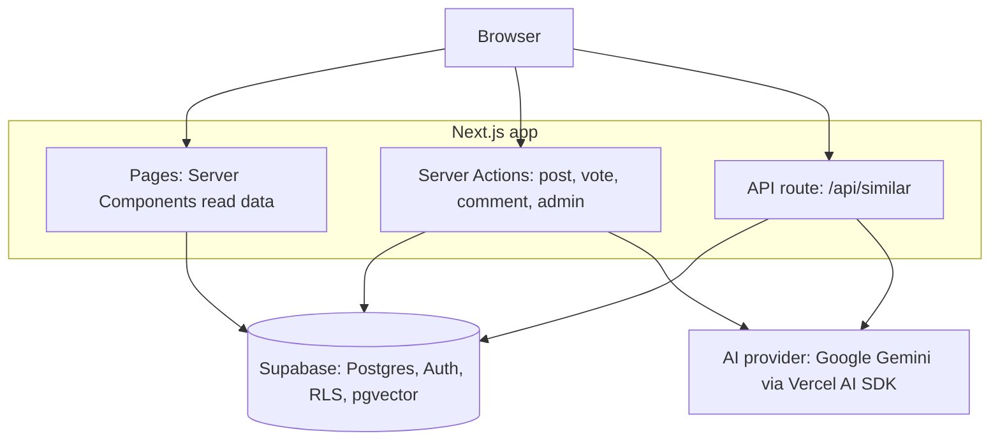
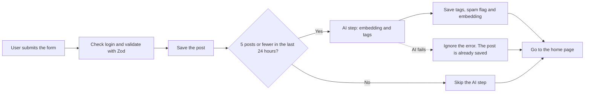

# Feature Flow

Feature Flow is a website where users share product ideas and bug reports.
Other users can upvote and comment. An admin moves each idea across a roadmap.
It also has two small AI features: it finds similar ideas, and it adds tags to new posts.

**Status:** works on my computer. Not deployed yet.

[Live demo](TODO_LIVE_URL) · [Demo video](TODO_VIDEO_URL) · [Source code](TODO_GITHUB_URL)


<!--
HOW TO EDIT THE LINKS ABOVE
- Live demo: put the Vercel link after you deploy. Until then, delete "[Live demo](TODO_LIVE_URL) · ".
- Demo video: put your LinkedIn post link or a YouTube (unlisted) link.
- Source code: your GitHub repo link.
-->


<!--
SCREENSHOT 1 (hero image): the home page on desktop, logged in, with 4-5 posts and the Trending sidebar.
Save it as docs/screenshots/home-desktop.png (create the folder docs/screenshots in your project).
-->

## Table of contents

1. [What is this project?](#what-is-this-project)
2. [Screenshots](#screenshots)
3. [Features](#features)
4. [Tech stack](#tech-stack)
5. [How it works](#how-it-works)
6. [Database](#database)
7. [Security](#security)
8. [AI features in detail](#ai-features-in-detail)
9. [Run it on your computer](#run-it-on-your-computer)
10. [What I did not build, and known limits](#what-i-did-not-build-and-known-limits)
11. [What I learned](#what-i-learned)
12. [How I used AI while building](#how-i-used-ai-while-building)
13. [Contact](#contact)

## What is this project?

Many companies collect ideas and bug reports in different places. Feature Flow puts them in one public board:

- Users post ideas, upvote the ones they like, and comment.
- The admin changes the status of each idea. The roadmap shows four columns: Under review, Planned, In progress, Completed.
- Before a user posts, they can click a button to check if a similar idea already exists.

It is a project for one company only. It is not a product for many companies.
I built it to practise the basics of a full-stack app: database design, login, row level security (RLS), server-first Next.js, input checks, and small AI features that do not break the main app.

## Screenshots

| Mobile feed                                      | Post details with AI tags                          |
| ------------------------------------------------ | -------------------------------------------------- |
|  |  |

| Similar ideas check                                  | Roadmap                                  |
| ---------------------------------------------------- | ---------------------------------------- |
|  |  |

| Admin dashboard                                          |
| -------------------------------------------------------- |
|  |

<!--
SCREENSHOTS TO TAKE (save each in docs/screenshots/ with the same file name):
1. home-mobile.png      -> home page in the phone view (browser DevTools, width 375).
2. post-details.png     -> one post page that shows the colored AI tags and the comments.
3. similar-ideas.png    -> the New feedback page after you click "Check similar ideas" and matches are shown.
4. roadmap.png          -> the Roadmap page with posts in the columns.
5. admin-dashboard.png  -> /admin as admin: the four number cards, the category bars, and the lists.
Tips: use dark or light mode, but use the same one for all pictures. Do not show your email or any private data.
If you do not want a screenshot, delete its table cell.
-->

## Features

**Public**

- Home feed with search (by title), category filter and sort (newest or most upvoted). It shows the latest 20 posts.
- The search, filter and sort are saved in the URL, so you can share a link.
- Trending sidebar with the 5 most upvoted posts.
- Roadmap page with four columns.
- Post page with the full text, upvote button and comments.
- One vote per user per post. Click again to remove your vote.
- Delete your own post or comment. It is a "soft delete": the row stays in the database, and the page shows a small "deleted" message.
- Login with email and password, or with Google.
- Mobile-first design and dark mode.

**AI**

- "Check similar ideas" button on the new post form. It shows up to 3 similar existing ideas.
- After you post, the app adds up to 3 tags. It also flags posts that look like spam.

**Admin**

- Admin link in the navbar (only the admin can see it).
- Dashboard with four numbers: open posts, waiting for review, flagged by AI, completed. Also a bar list of posts per category.
- "Flagged by AI" list. The admin can dismiss a flag.
- "Deleted posts" list. The admin can restore a post.
- The admin changes the status of a post on the post page.

## Tech stack

| Part               | Technology                               | Why                                                                          |
| ------------------ | ---------------------------------------- | ---------------------------------------------------------------------------- |
| Framework          | Next.js (App Router) and React 19        | Server Components read data on the server. Server Actions handle the writes. |
| Language           | TypeScript                               | Finds mistakes early.                                                        |
| Database and login | Supabase (Postgres, Auth, RLS, pgvector) | One place for data, login and vector search.                                 |
| Styling            | Tailwind CSS v4 and shadcn/ui            | Fast to build, easy to make responsive.                                      |
| Validation         | Zod                                      | Checks all input in actions and API routes.                                  |
| AI                 | Vercel AI SDK with Google Gemini         | Embeddings and typed (structured) output.                                    |

## How it works

### The big picture



In short: pages read data on the server. All writes go through Server Actions. The "Check similar ideas" button calls one API route. The AI provider is only used for embeddings and tags.

### What happens when you create a post



The most important rule: **AI is a bonus, not a requirement.** The post is saved first. If the AI is slow or broken, posting, voting and commenting still work.

## Database

| Table or object                     | What it is for                                                                                                |
| ----------------------------------- | ------------------------------------------------------------------------------------------------------------- |
| `profile`                           | One row per user: name, avatar and role (`USER` or `ADMIN`).                                                  |
| `feedback`                          | The posts. It has soft delete columns and AI columns (`tags`, `ai_flagged`, `ai_flag_reason`).                |
| `comment`                           | Comments on a post, with soft delete.                                                                         |
| `vote`                              | One row per vote. A unique pair (post, user) stops double votes.                                              |
| `feedback_embeddings`               | One vector (768 numbers) per post, and the model name.                                                        |
| `vw_feedback_details` (view)        | Posts with the author and the vote and comment counts. The counts are made in SQL, so a page needs one query. |
| `match_similar_feedback` (function) | Finds the posts closest to a vector, using cosine distance.                                                   |

The full SQL is in [`supabase/schema.sql`](supabase/schema.sql).

<!--
TODO: save the SQL file I gave you (feature_flow_schema.sql) in your project as supabase/schema.sql,
or change the path above to where you saved it.
-->


<!--
OPTIONAL screenshot: Supabase Dashboard -> Database -> Schema Visualizer. Take a picture of the 5 tables.
Save as docs/screenshots/database-diagram.png. If you skip it, delete the image line above.
-->

## Security

I use several small layers, so one mistake does not open everything.

- **RLS is on for every table.** The database decides who can read or change which rows. Example: you can only insert a post with your own `user_id`.
- **Admin checks happen on the server.** The admin page and every admin action call `requireAdmin()` first. Hiding a button is not security, because a Server Action can be called directly.
- **Users cannot make themselves admin.** The update policy on `profile` does not allow a role change. The first admin is made by hand with one SQL line.
- **The secret key stays on the server.** It is used in one file (`src/lib/supabase/admin.ts`) that starts with `import "server-only"`. It is never in a `NEXT_PUBLIC_` variable.
- **All input is checked with Zod.** The search text is cleaned before it is used in the database filter.
- **AI is limited.** Only the first 5 posts per user per day get the AI step. AI never deletes or edits a post by itself.

Checks I plan to do by hand. I will fill in the last column after I test them:

| #   | What I try                                    | Expected                 | Result |
| --- | --------------------------------------------- | ------------------------ | ------ |
| 1   | A normal user changes their own role to ADMIN | Blocked                  | TODO   |
| 2   | A normal user edits someone else's post       | Blocked (0 rows changed) | TODO   |
| 3   | Open `/admin` when logged out                 | Redirected to login      | TODO   |
| 4   | Open `/admin` as a normal user                | Forbidden page           | TODO   |
| 5   | Put a wrong AI key and create a post          | Post is saved, no tags   | TODO   |

<!--
TODO: do each check, then write "Pass" in the Result column. Only write "Pass" if you really tested it.
If you did not test a check, delete that row.
-->

## AI features in detail

| Item               | Value                                                                |
| ------------------ | -------------------------------------------------------------------- |
| Embedding model    | `gemini-embedding-001`                                               |
| Vector size        | 768 (the database column must be the same size)                      |
| Tag and spam model | TODO_MODEL_NAME (it is set in the `LLM_MODEL` variable)              |
| Similarity         | Cosine similarity (1 minus cosine distance)                          |
| Search             | Exact search. With a few hundred posts I do not need a vector index. |
| AI limit           | The first 5 posts per user in 24 hours get the AI step               |

**Duplicate check.** When you click "Check similar ideas", the app turns your title and description into a vector. Then the database finds the 3 closest posts above a similarity threshold. The app never blocks posting. If the AI is down, the button shows "AI suggestions are temporarily unavailable".

**Tags and spam flag.** After a post is saved, the app asks the model for up to 3 tags and a spam flag with a short reason. The answer must match a Zod schema. A flagged post goes to the admin page. A human decides what to do. The AI never deletes anything.

**The threshold.** I started with 0.8. I want to test it with my own examples:

| Type        | Example | Score |
| ----------- | ------- | ----- |
| Duplicate   | TODO    | TODO  |
| Duplicate   | TODO    | TODO  |
| Not related | TODO    | TODO  |
| Not related | TODO    | TODO  |

My chosen threshold: TODO. I tested it on a very small set, so I do not say it is accurate in general.

<!--
TODO (10 minutes): create 2 pairs of posts that mean the same thing and 2 pairs that are different.
Use the "Check similar ideas" button. It shows the match percent (for example 87%). Write the scores in the table.
Then pick a threshold between the duplicate scores and the unrelated scores, and change SIMILARITY_THRESHOLD in src/lib/ai.ts.
If you do not do this test, delete the table and this paragraph, and write: "The threshold (0.8) was not tested yet."
Also write the real chat model name in the first table (look at your LLM_MODEL value).
-->

## Run it on your computer

You need: Node.js 20 or newer, a free [Supabase](https://supabase.com/) project, and a Google AI (Gemini) API key. For Google login you also need a Google Cloud OAuth client (optional).

**1. Clone and install**

```bash
git clone TODO_GITHUB_URL
cd feature-flow-full-stack-app
npm install
```

**2. Create the database.** In Supabase, open the SQL Editor and run [`supabase/schema.sql`](supabase/schema.sql).

**3. Set up login.** In Supabase go to Authentication, then URL Configuration.
Set Site URL to `http://localhost:3000`. Add `http://localhost:3000/auth/callback` to the Redirect URLs.
For Google login, create a Web OAuth client in Google Cloud. Use the Supabase callback URL as its redirect URI. Then paste the client ID and secret in Authentication, Providers, Google.

**4. Add environment variables.** Copy `.env.example` to `.env.local` and fill it in:

| Variable                               | Used for                                                  |
| -------------------------------------- | --------------------------------------------------------- |
| `NEXT_PUBLIC_SUPABASE_URL`             | Supabase project URL                                      |
| `NEXT_PUBLIC_SUPABASE_PUBLISHABLE_KEY` | Supabase public key (check the name in your `.env.local`) |
| `SUPABASE_SECRET_KEY`                  | Server-only key for AI writes. Never share it.            |
| `GOOGLE_GENERATIVE_AI_API_KEY`         | Gemini API key                                            |
| `LLM_MODEL`                            | Model name for tags and spam flag                         |

**5. Start the app**

```bash
npm run dev
```

Open [http://localhost:3000](http://localhost:3000).

**6. Make yourself admin.** Sign up first. Then run this once in the Supabase SQL Editor, with your email:

```sql
update public.profile set role = 'ADMIN'
where id = (select id from auth.users where email = 'you@example.com');
```

**Useful commands**

| Command         | What it does         |
| --------------- | -------------------- |
| `npm run dev`   | Start the dev server |
| `npm run build` | Production build     |
| `npm run lint`  | Check the code style |

<!--
TODO: check that .env.example exists in your project and that the names above match it.
There is no seed script and no demo login in this project. If you add them later, add the steps here.
-->

## What I did not build, and known limits

**Testing.** I test by hand. I have no automated tests yet. A Vitest test for the URL parser is planned.

**Deployment.** The app is not deployed yet. I plan to use Vercel for the app and Supabase for the database.

**Things I cut on purpose.** My first plan was bigger. I cut features I could not explain well yet:

| Cut                                  | Reason                                                           |
| ------------------------------------ | ---------------------------------------------------------------- |
| Pagination                           | The feed shows the latest 20 posts. Pagination is the next step. |
| Optimistic upvote                    | Extra code for a small UX gain.                                  |
| Admin team page                      | One admin made by hand is enough for now.                        |
| AI usage log table and urgency score | A simple "5 posts per day" check is easier to understand.        |
| Charts and a bigger dashboard        | Four numbers and simple bars are enough.                         |
| Vector index                         | Exact search is fast for a few hundred posts.                    |
| Demo accounts and seed script        | I add demo data by hand.                                         |

**Known limits (honest list)**

- RLS controls rows, not columns. A user who calls the API directly could edit other columns of their own post. My Server Actions only send allowed fields. Column-level permissions would be the next fix.
- Deleted posts can still be read through the API. The page only shows a "deleted" message.
- Votes are public, so anyone can see who voted.
- The AI step runs while the user waits (about 1 to 3 seconds). A background job would be better.
- The duplicate check needs a login but has no daily limit yet.
- The AI only works for posts created after the AI step was added, or for posts that were embedded by hand.
- I did not test the similarity threshold much.

## What I learned

- **RLS is a second lock.** I learned the difference between `USING` (which existing rows) and `WITH CHECK` (what the new row may look like).
- **Server Actions are public endpoints.** Hiding a button is not enough. Every admin action checks the role on the server.
- **The URL is good for state.** Zod turns messy URL values into safe values.
- **N+1 queries.** One query for "my votes" is better than one query per card.
- **Embeddings.** Text becomes a vector. Similar text gives close vectors. I use cosine distance to find them.
- **AI must be optional.** Timeouts, try/catch and a daily limit keep the app working when the model fails.
- **Cutting scope is a skill.** I kept what I can explain and cut the rest.

## How I used AI while building

I used AI assistants (like ChatGPT and Claude) a lot in this project:

- to explain concepts (RLS, Server Actions, embeddings),
- to suggest and review code,
- to fix errors,
- to help write this README and my planning notes.

I ran and tested the code on my computer, fixed the errors, and decided which features to keep or cut. I am still learning. These are the parts I can explain well: TODO_EDIT_THIS.

<!--
IMPORTANT - be honest here. Edit the last line to match what you really can explain.
Examples: "the admin guard, the RLS policies, the feed query, and how the duplicate check works."
Only write what you can explain in an interview without notes. Remove anything you are not sure about.
-->

## Contact

Asim Momin · Full-stack developer (fresher)

[Portfolio](TODO_PORTFOLIO_URL) · [LinkedIn](TODO_LINKEDIN_URL) · TODO_EMAIL
